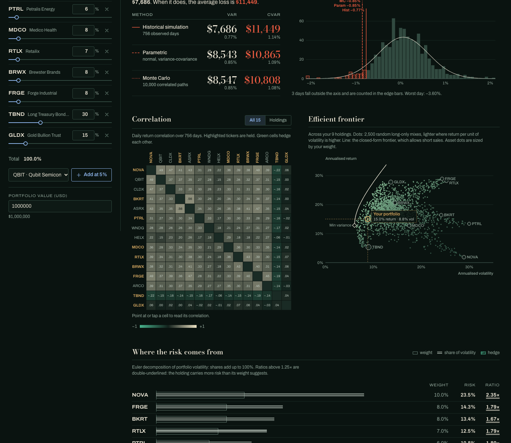

# riskboard

[](https://github.com/TheWingTheWong/riskboard/actions/workflows/ci.yml)

A portfolio risk dashboard that runs entirely in the browser. Edit a portfolio's tickers and weights and riskboard recomputes Value at Risk three ways (historical, parametric, Monte Carlo), expected shortfall, volatility, beta, the correlation matrix, each holding's share of risk and the mean-variance efficient frontier.



> **The bundled data is synthetic.** The 15 assets (NOVA, QBIT, TBND, ...) and the RBX index are fictional. Their 756 days of returns come from a seeded factor model in [`src/data/generate.ts`](src/data/generate.ts), not from any market. The UI says so in its masthead.

## Why

Most VaR explanations show one method on one made-up normal distribution. riskboard puts the three standard methods side by side on the same fat-tailed data, so you can see where they agree and where they don't. The math lives in a small TypeScript module with no dependencies, and every formula has a test.

An example of what the side-by-side shows. The **Growth** preset at 99% confidence, one day:

| Method | VaR | CVaR (expected shortfall) |
| --- | ---: | ---: |
| Historical simulation (756 days) | 2.93% | **4.28%** |
| Parametric (normal) | 2.92% | 3.36% |
| Monte Carlo (10,000 paths) | 2.95% | 3.35% |

The three VaR figures agree to within 0.03 percentage points. The shortfalls do not: on the worst 1% of days the observed losses averaged 4.28%, and the normal models put that at about 3.35%. The generator gives returns Student-t shocks and a stress episode, and the normal assumption misses that tail. The **Defensive** preset (40% bonds, 20% gold) shows it much less: historical CVaR 1.13% against 1.01% parametric.

## Quickstart

Requires Node 22.12 or newer.

```bash
npm install
npm run dev        # http://localhost:5173
npm test           # vitest, risk module + data + UI state
npm run build      # static site in dist/
npm run preview    # serve dist/ locally
```

`dist/` is plain static files with relative asset paths, so you can put it on GitHub Pages, S3 or any file server. Nothing is fetched at runtime: fonts are bundled and there are no API calls.

## What it computes

All figures are losses expressed as positive fractions of portfolio value, then multiplied by the portfolio value you enter.

| Measure | How |
| --- | --- |
| Historical VaR / CVaR | Type-7 quantile of realised daily portfolio returns; CVaR is the mean of returns at or below that quantile. 10-day uses square-root-of-time. |
| Parametric VaR / CVaR | `VaR = -(μ + zσ)`, `CVaR = -(μ - σφ(z)/(1-c))`, with `z = Φ⁻¹(1-c)` from Acklam's inverse refined by a Halley step. |
| Monte Carlo VaR / CVaR | 10,000 draws of `x = μ + Lz`, where `L` is the Cholesky factor of the sample covariance and `z` is i.i.d. standard normal. Seeded, so the same portfolio gives the same number. |
| Volatility | Sample standard deviation of daily returns × √252. |
| Beta | `cov(portfolio, RBX) / var(RBX)`. |
| Risk contribution | Euler decomposition `wᵢ(Σw)ᵢ / σ`. Contributions add up to total volatility; a hedge can be negative. |
| Efficient frontier | 2,500 random long-only portfolios (Dirichlet weights) plus the closed-form frontier `σ²(μ) = (aμ² − 2bμ + c)/d` and global minimum-variance portfolio `Σ⁻¹1 / 1ᵀΣ⁻¹1`. The closed-form curve allows short sales, which is why it sits left of the long-only cloud. |
| Max drawdown | Largest peak-to-trough fall of the compounded daily path. |

For a 15-asset portfolio the whole analysis (including the Monte Carlo run and the frontier cloud) takes about 25 ms on a laptop, so every panel updates as you drag a weight slider.

## Using it

- **Holdings**: type a weight or drag its slider. Weights that don't add to 100% are rescaled for the figures, and a button rescales the inputs for you. Presets: Balanced, Growth, Defensive, all 15 equal.
- **Confidence** slider snaps to 90, 95 and 99%. **Horizon** is 1 or 10 trading days.
- **Histogram**: daily portfolio returns, with bars beyond the historical VaR hatched, a fitted normal curve, and one line per method.
- **Correlation**: all 15 assets or only your holdings; held tickers are highlighted, hover any cell for the value.
- **Frontier**: your portfolio is the bronze ring; asset dots are sized by your weight.
- **Where the risk comes from**: weight against share of volatility per holding, ranked. Rows slide to their new rank when you change weights.
- The URL hash holds the whole portfolio (`#p=NOVA:10,TBND:30&c=95&h=1&v=1000000`), so a link reproduces the view.

## Architecture

```
src/
  risk/            pure TypeScript, no DOM, no dependencies
    rng.ts         mulberry32, Marsaglia polar normals, unit-variance Student-t
    stats.ts       mean, covariance/correlation matrices, quantiles
    normal.ts      Φ (Hart/West, ~1e-14), Φ⁻¹ (Acklam + Halley)
    linalg.ts      Cholesky with jitter fallback, SPD solve, quadratic forms
    var.ts         historical, parametric, Monte Carlo VaR and CVaR
    portfolio.ts   portfolio returns, beta, drawdown, Euler risk contributions
    frontier.ts    random portfolios, closed-form frontier, min-variance
    analyze.ts     one-call analyzePortfolio / analyzeFrontier used by the UI
  data/
    generate.ts    seeded factor-model generator (GARCH market, sector factors)
    returns.json   committed output; a test checks it regenerates exactly
  state/           holdings, presets, URL-hash encoding, the analysis hook
  charts/          hand-written SVG: histogram, heatmap, frontier, risk rows
  components/      masthead, holdings editor, VaR panel, statement line
scripts/
  generate-data.ts  npm run generate:data [seed]
```

The `risk` module never imports React or touches the DOM. The UI calls `analyzePortfolio` and `analyzeFrontier` inside `useMemo`, so changing the confidence level doesn't regenerate the frontier, and changing a weight doesn't rebuild the universe correlation matrix.

### The synthetic data

`generate.ts` builds each asset as

```
r = α + β·market + λ·sector + σ_idio·t₅
```

The market factor follows GARCH(1,1) with Student-t(5) shocks and a gap-down stress episode partway through. Each equity has a sector factor; the bond fund has a negative market beta and its own rates factor; gold is nearly uncorrelated. The result has fat tails, volatility clustering, sector co-movement and a working equity/bond hedge (NOVA vs TBND correlation is about −0.2). All of these are checked in `src/data/data.test.ts`.

To regenerate: `npm run generate:data`. Pass a different seed to get a different market, though the data test will then fail until you change `DEFAULT_SEED` too.

### Tests

`npm test` runs vitest over:

- closed-form checks: normal quantiles and expected shortfall, the textbook Cholesky example, Euler contributions summing to σ, marginal contributions matching finite differences, frontier weights landing on the Merton hyperbola
- statistical checks: Monte Carlo VaR converging to parametric VaR, simulated draws reproducing the input covariance, historical and parametric VaR agreeing on a large normal sample
- the frontier dominating 2,000 random long-only portfolios, and the minimum-variance portfolio beating every one of them
- the dataset regenerating exactly from its seed, plus URL-hash round trips and preset integrity

## Design

The visual direction is security printing: the intaglio green of banknote ink for the ground and every neutral (one stepped ramp), Didone numerals for money amounts, and fine-line hatching for anything past a loss threshold. Colours have fixed jobs: vermilion means loss, bronze means your portfolio, blue means a control you can operate. The guilloche rule under the masthead is drawn from the portfolio's volatility, so it gets busier as risk rises. Risk shares are drawn as engraved ruling, and the summary line sits between two microprint rules. [`DESIGN.md`](DESIGN.md) records the tokens and rules.

## Limitations

- Returns are simple daily returns with daily rebalancing to target weights; there are no transaction costs.
- 10-day historical VaR uses square-root-of-time scaling, which ignores autocorrelation and volatility clustering.
- Monte Carlo draws are multivariate normal, so like the parametric method it understates fat tails.
- Long-only weights. The closed-form frontier line includes short positions; the random cloud does not.

## Roadmap

- Import your own returns from CSV (date column plus one column per ticker).
- Filtered historical simulation (EWMA or GARCH-scaled returns) as a fourth VaR method.
- Student-t Monte Carlo and Cornish-Fisher VaR to model the tail explicitly.
- VaR backtesting: count exceptions over a rolling window with the Kupiec test.
- Long-only efficient frontier via quadratic programming instead of the random cloud.
- Stress scenarios: replay the generator's stress episode, or apply user-defined shocks per sector.

## License

MIT. See [LICENSE](LICENSE).
